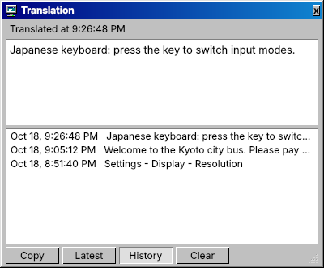
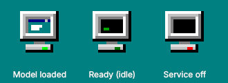
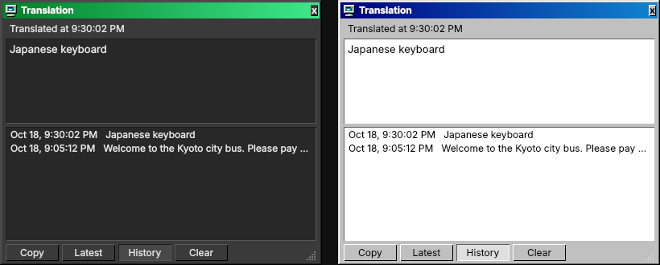

# Cathode Translate

**Translate any text on your screen with a local AI model, styled for the [Cathode](https://github.com/Zachygd/Cathode-KDE-Theme) Windows 98 KDE theme.**

Press a hotkey, drag a box around text in any app, game, video or image, and the translation appears in a small always-on-top window. Recognition and translation run entirely on your own GPU through [Ollama](https://ollama.com): **nothing you capture is ever sent to the internet.**



## Features

- **Works on anything you can see**, including text you can't select: game menus, video subtitles, images, signs in photos, UI in other languages.
- **Fully local and private.** Spectacle grabs the area, a local vision model reads and translates it, and the result never leaves your PC.
- **Fast.** Translations stream in word by word, usually within a second or two once the model is loaded.
- **A small, out-of-the-way window.** It stays on top without stealing focus, can be dragged and resized, remembers where you put it, and updates in place on each capture.
- **History** of your last 200 translations with timestamps, plus a one-click **Copy** button.
- **Follows your theme.** Colors, the title bar gradient and the font come from your active KDE color scheme and update live when you switch Cathode variants or light/dark mode.
- **Tray indicator** with a pixel-art 98-style icon that shows whether the model is loaded. Hover for VRAM and GPU stats; right-click to load or unload the model and start or stop Ollama.
- **Frees GPU memory automatically** after a configurable idle time.

<p>
  
</p>



---

## Requirements

| | |
|---|---|
| **OS** | Fedora 44 (or newer) with **KDE Plasma 6**, Wayland or X11. Built for Cathode, but works on any Plasma 6 theme. |
| **GPU** | **Recommended:** NVIDIA with 6 GB+ VRAM (RTX 20-series or newer) and the RPM Fusion driver. AMD GPUs supported by ROCm also work. Without a GPU it runs on the CPU, which is much slower. |
| **Disk** | About 4 GB for Ollama plus about 3.3 GB for the default model. |
| **RAM** | 8 GB+ |

### Dependencies

The installer installs all of these for you.

| Package | Why | Source |
|---|---|---|
| `python3-pyqt6` | The tray app and translation window | Fedora repos |
| `spectacle` | Screen-area capture (KDE's screenshot tool) | Fedora repos |
| `curl` | Talking to Ollama and installing it | Fedora repos |
| **Ollama** | Runs the AI model locally as a background service | [ollama.com](https://ollama.com) (official installer) |
| `qwen3-vl:4b-instruct` | The vision model that reads and translates | Downloaded through Ollama |
| NVIDIA driver *(optional)* | GPU acceleration on NVIDIA cards | [RPM Fusion](https://rpmfusion.org/Howto/NVIDIA) |

XWayland is also used, and is included with Plasma by default. It's what lets the translation window stay on top and be positioned freely on Wayland.

---

## Installation

### 1. NVIDIA users: install the driver first

Skip this if `nvidia-smi` already shows your GPU.

```bash
# Enable RPM Fusion if you haven't already
sudo dnf install \
  https://mirrors.rpmfusion.org/free/fedora/rpmfusion-free-release-$(rpm -E %fedora).noarch.rpm \
  https://mirrors.rpmfusion.org/nonfree/fedora/rpmfusion-nonfree-release-$(rpm -E %fedora).noarch.rpm

sudo dnf install akmod-nvidia xorg-x11-drv-nvidia-cuda
# Wait ~5 minutes for the kernel module to build, then reboot
```

### 2. Run the installer

```bash
git clone https://github.com/Zachygd/Translate-plugin-Cathode.git
cd Translate-plugin-Cathode
./install.sh
```

Run it as your normal user, not with `sudo`; it asks for your password when it needs it. The installer:

1. Installs the dependencies above.
2. Installs Ollama if it's missing and makes sure its service is running.
3. Adds Ollama speed settings (flash attention, smaller KV cache).
4. Downloads the vision model.
5. Allows your user to start and stop Ollama from the tray menu without a password, for that one service only.
6. Installs the app, its menu entry and its login autostart, and then starts it.

### Installer options

| Option | What it does |
|---|---|
| `--model NAME` | Use a different model (see [Choosing a model](#choosing-a-model)) |
| `--models-dir DIR` | Store Ollama models somewhere else, e.g. a second drive: `--models-dir /mnt/data/ollama-models` |
| `--no-tuning` | Don't add the Ollama speed settings |
| `--no-ollama` | Skip all Ollama setup, for when you manage Ollama yourself |
| `-y`, `--yes` | Accept all defaults without asking |

Examples:

```bash
./install.sh --model qwen3-vl:2b-instruct          # lighter model for smaller GPUs
./install.sh --models-dir /mnt/data/ollama-models   # keep models on a second drive
```

Running the installer again is safe. It updates the app and keeps your settings and history.

---

## Usage

| Action | How |
|---|---|
| **Translate an area** | Press **Meta + Shift + T** (Windows key + Shift + T), or left-click the tray icon, then drag a box around the text. Press **Esc** to cancel. |
| **Show the window again** | Right-click the tray icon, then **Show translation window**. |
| **See past translations** | Click **History** in the window. Click an entry to view it, and **Latest** to go back. |
| **Copy the translation** | Click **Copy**. |
| **Move or resize** | Drag the title bar; drag the bottom-right corner. |
| **Free GPU memory now** | Right-click the tray icon, then **Unload model**. Useful before gaming. |
| **Start or stop Ollama** | Right-click the tray icon, then **Start/Stop Ollama service**. |

### Tray icon states

| Icon | Meaning |
|---|---|
| Teal screen, green light | Model is loaded in GPU memory, so translations are instant |
| Black screen, dim light | Ollama is running and nothing is loaded; the first translation takes a few extra seconds to load the model |
| Black screen, red light | The Ollama service is off |

Hover over the icon to see the loaded model, its VRAM use, when it will unload, and your GPU's memory, temperature and load.

### Setting the hotkey

The installer registers **Meta + Shift + T**. If that doesn't work or you want a different key:

1. Open **System Settings → Keyboard → Shortcuts**.
2. Click **Add New → Application…** and choose **Cathode Translate**.
3. Select **Translate Screen Region** and assign your key.

You can also bind the command `~/.local/bin/cathode-translate --translate` to any shortcut tool.

---

## Configuration

Settings are in `~/.config/cathode-translate/config.ini`. After editing it, restart the app: right-click the tray icon, choose **Quit indicator**, then launch **Cathode Translate** from the app menu.

| Setting | Default | Description |
|---|---|---|
| `model` | `qwen3-vl:4b-instruct` | The Ollama vision model to use |
| `target_language` | `English` | Language to translate into, e.g. `Spanish`, `Ukrainian`, `Japanese` |
| `keep_alive` | `1h` | How long the model stays in GPU memory after your last capture (`10m`, `1h`, `0`, or `-1` for forever) |
| `max_image_side` | `1280` | Large grabs are shrunk to this size. Lower is faster; higher is better for tiny text. |
| `ollama_url` | `http://localhost:11434` | Where Ollama is running |
| `ollama_service` | `ollama` | Name of Ollama's systemd service |
| `prompt` | *(empty)* | Optional custom instruction that replaces the built-in one |

### Choosing a model

Always use an **`-instruct`** model. The plain tags (e.g. `qwen3-vl:4b`) are "thinking" models: they reason before answering, which makes them many times slower and can produce blank results.

| Model | Download | VRAM | Notes |
|---|---|---|---|
| `qwen3-vl:2b-instruct` | ~1.9 GB | ~4 GB | Fastest; weaker on small or messy text |
| `qwen3-vl:4b-instruct` | ~3.3 GB | ~6 GB | **Default.** Best balance for 6–8 GB cards |
| `qwen3-vl:8b-instruct` | ~6.1 GB | ~10–12 GB | Best accuracy, especially for CJK and tiny text |

To switch models:

```bash
ollama pull qwen3-vl:8b-instruct
# then set  model = qwen3-vl:8b-instruct  in config.ini and restart the app
```

---

## Privacy

- Everything runs on your machine. The app only talks to Ollama at `localhost:11434`, and by default Ollama only accepts connections from your own computer. Check with `ss -tlnp | grep 11434`, which should show `127.0.0.1`.
- Each capture is saved as one image file in `$XDG_RUNTIME_DIR` (`/run/user/<id>/`), which lives in RAM. It's overwritten on every capture and wiped when you log out.
- History stores **text only** (no images) in `~/.local/share/cathode-translate/history.json`.
- The internet is used only to download Ollama and the model during installation. After that, translation works fully offline.

---

## Uninstalling

```bash
./uninstall.sh           # keeps your settings and history
./uninstall.sh --purge   # also deletes settings and history
```

This removes the app, its menu and autostart entries, the polkit rule and the speed settings. Ollama and your downloaded models are left alone. To remove those too, see the commands the uninstaller prints at the end.

---

## Troubleshooting

**The window says "Can't reach Ollama"**
The service isn't running. Right-click the tray icon and choose **Start Ollama service**, or run `sudo systemctl start ollama`. If it won't stay up, check `journalctl -u ollama -n 30`.

**The window says "Ollama error: model ... not found"**
The model in your config hasn't been downloaded yet. Run `ollama pull <model name>`.

**Results are blank or very slow**
Make sure you're using an `-instruct` model (see [Choosing a model](#choosing-a-model)). Then check that it's running on the GPU: do a capture and run `ollama ps`. It should say **100% GPU**. If it shows a CPU/GPU split, close other GPU-heavy apps (games, Steam) or use a smaller model. If it says CPU only, your GPU driver isn't working.

**"No text found in that area"**
Try a slightly bigger box around the text, or zoom in on very small text first.

**The tray icon isn't visible**
Click the **^** arrow in your system tray. To keep it visible, right-click the tray, choose **Configure System Tray → Entries**, and set Cathode Translate to **Always shown**. If it isn't running at all, launch **Cathode Translate** from the app menu.

**The hotkey does nothing**
Set it manually; see [Setting the hotkey](#setting-the-hotkey).

**Start/Stop in the tray menu doesn't work**
The polkit rule is missing. Re-run `./install.sh`, or check that `/etc/polkit-1/rules.d/50-cathode-translate.rules` exists.

**The window's text looks blurry**
This is caused by display scaling with XWayland apps. Go to **System Settings → Display & Monitor → Legacy Applications (X11)** and choose **Apply scaling themselves**.

**Colors don't match my theme**
The app reads your KDE color scheme from `~/.config/kdeglobals` and the system palette. Make sure a color scheme is applied in **System Settings → Colors & Themes → Colors**, then restart the app.

**Seeing what went wrong**
Quit the tray app and run it from a terminal to see its output:

```bash
~/.local/bin/cathode-translate
```

---

## Advanced: running Ollama from a second drive

To store models on another drive, use `./install.sh --models-dir /path`. To also put the Ollama program itself on another drive, with SELinux set up correctly, see [docs/ollama-on-second-drive.md](docs/ollama-on-second-drive.md).

---

## Files installed

| Path | What |
|---|---|
| `~/.local/bin/cathode-translate` | The app |
| `~/.config/cathode-translate/config.ini` | Your settings |
| `~/.config/cathode-translate/popup.conf` | Window position and size |
| `~/.local/share/cathode-translate/history.json` | Translation history (text only) |
| `~/.local/share/applications/cathode-translate.desktop` | App menu entry and hotkey action |
| `~/.config/autostart/cathode-translate.desktop` | Starts the tray app at login |
| `/etc/polkit-1/rules.d/50-cathode-translate.rules` | Lets you start and stop Ollama without a password |
| `/etc/systemd/system/ollama.service.d/20-cathode-translate-speed.conf` | Ollama speed settings |
| `/etc/systemd/system/ollama.service.d/10-cathode-translate-models.conf` | Models location (only with `--models-dir`) |

## How it works

1. The hotkey runs `cathode-translate --translate`, which tells the running tray app (over a local socket) to start a capture.
2. The app hides its window and runs **Spectacle** in region mode to grab the area you select.
3. The image is shrunk if it's large, then sent to **Ollama** on `localhost` with a short "translate this into English" instruction.
4. The reply streams back and appears in the window word by word. When it's done, it's added to the history.

---

Part of the **Cathode** project by [Zachygd](https://github.com/Zachygd).
